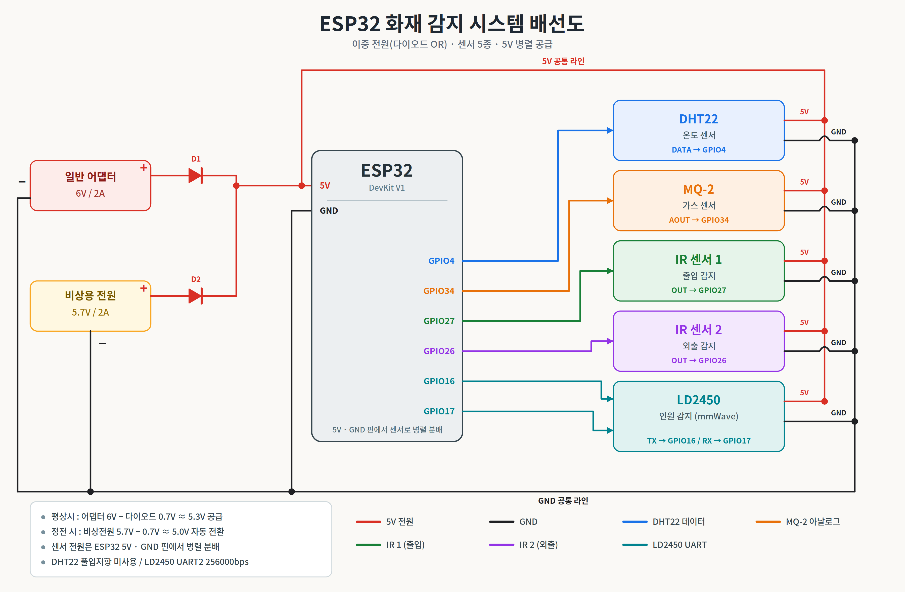
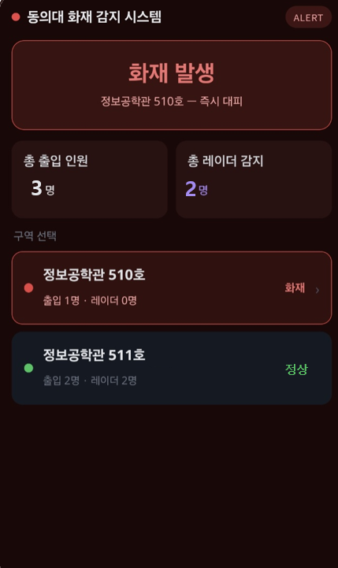
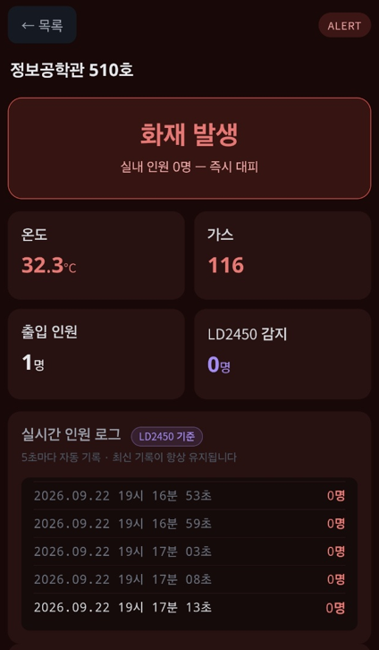
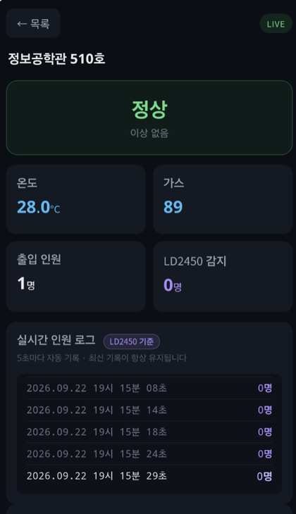
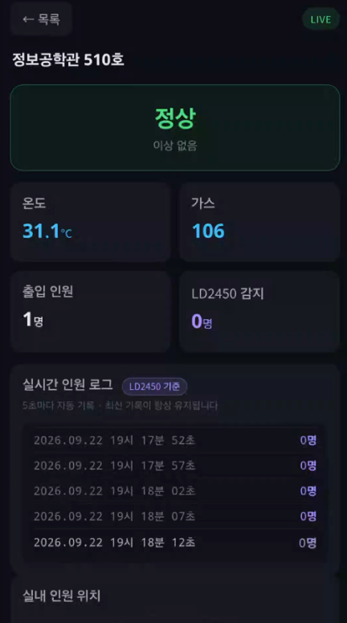

# 화재 상황 인원탐지 시스템

ESP32 하나로 화재 여부와 실내 인원을 함께 파악하고, 그 결과를 ESP32가 직접 띄우는 웹 대시보드로 보여주는 시스템입니다.

> 동의대학교 캡스톤디자인 I · 4인 팀 · 2026.03.02 ~ 2026.06.22

---

## 프로젝트 소개

화재가 나면 구조자는 "불이 났는지"와 "안에 사람이 몇 명 남아 있는지"를 동시에 알아야 합니다.
이 시스템은 온도·가스 센서로 화재를 판단하고, 출입구 IR 센서와 mmWave 레이더(LD2450)로 실내 인원을 파악합니다.
측정값은 1초마다 웹 대시보드에 갱신되므로 휴대폰 브라우저로 바로 확인할 수 있습니다.

mmWave 레이더는 카메라와 달리 연기 속에서도 사람을 감지할 수 있습니다. 그래서 인원 확인용 센서로 LD2450을 선택했습니다.

---

## 주요 기능

- **화재 판단**: 온도 5회 평균이 33.0°C 이상이거나, 가스 센서 값이 120 이상이면 화재로 판정
- **출입 인원 카운트**: IR 센서 2개가 감지되는 순서로 입실과 퇴실을 구분해 재실 인원 계산
- **인체 감지**: LD2450 레이더로 실내 인원 수(최대 3명)와 위치(X, Y)를 실시간 추적
- **웹 대시보드**: ESP32가 직접 웹서버를 띄움. 온도, 가스 농도, 재실 인원, 인체 감지 인원, 화재 상태, 실내 인원 위치, 실시간 감지 로그를 표시
- **기준 초과 표시**: 온도와 가스 중 기준을 넘은 항목만 빨간색으로 표시

---

## 하드웨어 구성

| 부품 | 역할 | ESP32 연결 |
|---|---|---|
| ESP32 DevKit V1 | 센서 판독, 화재 판단, 웹서버 | - |
| DHT22 | 온도 측정 | GPIO4 |
| MQ-2 | 가연성 가스 측정 (아날로그) | GPIO34 |
| IR 센서 1 | 출입 감지 | GPIO27 |
| IR 센서 2 | 외출 감지 | GPIO26 |
| HLK-LD2450 | 24GHz mmWave 레이더, 인원 수·위치 | TX → GPIO16, RX ↔ GPIO17 (UART2, 256000bps) |

센서 전원은 모두 5V, GND는 공통으로 연결합니다.

### 배선도



---

## 동작 방식

### 1. 화재 판단

- DHT22 온도를 5번 읽어 평균을 냅니다. 순간적인 튐 값에 반응하지 않기 위해서입니다.
- MQ-2 값은 ESP32 ADC로 읽은 값(0~4095)입니다. ppm으로 환산한 값은 아닙니다.
- `평균 온도 ≥ TEMP_LIMIT(33.0)` 또는 `가스 값 ≥ GAS_LIMIT(120)` 중 하나라도 맞으면 화재로 판정합니다.

### 2. 출입 인원 카운트 (IR 센서 2개)

- IR1 다음에 IR2가 감지되면 입실로 보고 +1 합니다.
- IR2 다음에 IR1이 감지되면 퇴실로 보고 -1 합니다.
- 한 번 센 직후 0.8초는 다시 세지 않습니다. 같은 사람을 두 번 세지 않기 위해서입니다.
- 첫 번째 센서가 감지된 뒤 2초 안에 두 번째 센서가 감지되지 않으면 무효로 처리합니다.

### 3. 인체 감지 (LD2450)

- LD2450은 UART로 30바이트짜리 프레임을 계속 보냅니다.
  - 프레임 구성: `AA FF 03 00`(시작) + 사람 3명분 데이터(각 8바이트) + `55 CC`(끝)
- ESP32는 시작 4바이트를 찾아 프레임을 맞추고, 끝 2바이트가 틀린 프레임은 버립니다.
- 사람마다 X, Y 좌표(mm)를 꺼내 m로 바꾸고, 좌표가 0이 아닌 사람 수를 인원 수로 셉니다.

### 4. 웹 대시보드

ESP32가 와이파이에 연결되면 시리얼 모니터에 IP 주소가 찍힙니다. 같은 와이파이에 연결된 휴대폰이나 PC에서 `http://IP주소`로 접속합니다.

| 주소 | 내용 |
|---|---|
| `/` | 대시보드 웹페이지 |
| `/rooms` | 전체 구역 상태 (JSON) |
| `/data?room=0` | 구역 상세 측정값 (JSON) |
| `/report` (POST) | 다른 ESP32가 측정값을 보내는 주소 (구역 확장용) |

### 개발 중 실제 화면

2026.09.22에 캡처한 화면입니다. 이후 항목 이름(예: 가스 → 가연성 가스 농도, 출입 인원 → 재실 인원)과 구역 구성이 일부 바뀌었습니다.

| 구역 목록 (화재) | 구역 상세 (화재) | 구역 상세 (정상) | 구역 상세 (정상) |
|---|---|---|---|
|  |  |  |  |

---

## 실행 방법

1. Arduino IDE에 ESP32 보드 패키지를 설치하고, 보드를 **ESP32 Dev Module**로 선택합니다.
2. 라이브러리 매니저에서 **DHT sensor library**(Adafruit)를 설치합니다. `WiFi`, `WebServer`는 ESP32 보드 패키지에 들어 있습니다.
3. `firmware/fire_detection_LD2450/fire_detection_LD2450.ino`를 엽니다.
4. 코드 위쪽의 와이파이 이름과 비밀번호를 바꿉니다.
   ```cpp
   const char* ssid = "YOUR_WIFI_SSID";
   const char* password = "YOUR_WIFI_PASSWORD";
   ```
5. 업로드한 뒤 시리얼 모니터(115200)에서 IP 주소를 확인합니다.
6. 브라우저에서 `http://IP주소`로 접속합니다. `https://`가 아니라 `http://`로 입력해야 합니다.

### 설정값

| 이름 | 기본값 | 뜻 |
|---|---|---|
| `TEMP_LIMIT` | 33.0 | 화재로 판단하는 평균 온도(°C) |
| `GAS_LIMIT` | 120 | 화재로 판단하는 가스 센서 값 |
| `LD_DEBUG` | false | true로 바꾸면 LD2450 통신 상태를 2초마다 시리얼에 출력 |

---

## 문제 해결 기록

### 와이파이에 연결되지 않음

- **증상**: 시리얼 모니터에 `.`만 계속 찍히고 연결되지 않음
- **원인**: ESP32는 2.4GHz 와이파이만 지원함. 휴대폰 핫스팟이 5GHz로 열려 있었음
- **해결**: 핫스팟 대역을 2.4GHz(호환성 모드)로 바꾸니 연결됨

### LD2450 감지값이 웹에 나오지 않음

- **증상**: 웹 대시보드의 인체 감지 인원이 계속 0명
- **원인**: 웹페이지가 열리는지 확인하려고 LD2450 읽기 함수(`readRadar()`)를 잠시 꺼둔 상태가 남아 있었음. 이 상태에서는 레이더 데이터를 아예 읽지 않음
- **해결**: `readRadar()`를 다시 켬. 안정성을 위해 아래 두 가지도 함께 넣음
  - UART 수신 버퍼를 256바이트에서 2048바이트로 확대 (`Serial2.setRxBufferSize`). 웹페이지를 보내는 동안 데이터가 넘치지 않게 함
  - loop 한 바퀴에 최대 240바이트만 읽도록 제한. 레이더 읽기 때문에 웹서버 응답이 밀리지 않게 함
- **진단 기능 추가**: `LD_DEBUG`를 true로 바꾸면 받은 바이트 수, 정상 프레임 수, 깨진 프레임 수, 인원 수, loop 최대 시간이 2초마다 출력됨. 배선 문제인지, 통신속도 문제인지, 센서가 사람을 못 잡는 것인지 구분할 수 있음

---

## 폴더 구성

```
fire-detection-system/
├─ README.md
├─ firmware/
│   └─ fire_detection_LD2450/
│       └─ fire_detection_LD2450.ino
└─ docs/
    └─ images/
        ├─ wiring.png
        ├─ web_list_fire.png
        ├─ web_room_fire.png
        ├─ web_room_normal_1.png
        └─ web_room_normal_2.png
```
